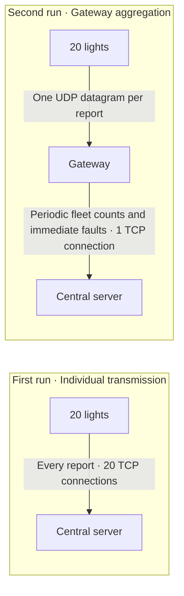

# Streetlight Network Lab

**How should a streetlight report a changing state, and how can a gateway confirm that a fault reached storage?** This networking assignment uses UDP datagrams for periodic device updates and a TCP stream for gateway-to-server delivery. A direct-TCP baseline lets us measure how much server-bound payload aggregation saves. All three roles run on one computer and communicate through real sockets on the loopback interface (`127.0.0.1`).

## Run the experiment

With Node.js 24.x installed, run `npm start` in this directory. On Windows PowerShell you can use `npm.cmd start`. Open [the dashboard](http://127.0.0.1:3000/) and select **Compare both routes**. Stop the server with Ctrl+C.

## How UDP and TCP work in this experiment

Both runs generate the same 12 rounds of device readings. In the baseline, each light maintains its own TCP connection. In the gateway run, the simulator sends readings to a local UDP port, and the gateway maintains one TCP connection to the server.

### UDP datagrams from lights to the gateway

Each status report fits in one UDP datagram. The simulator uses one `node:dgram` sender for 20 logical devices. It sends each JSON report to the gateway's bound port without first establishing a connection. Each receiver `message` event delivers a whole datagram. The gateway identifies the light by its `id` field. [UDP sender and receiver](demo.js)

UDP offers no guarantee of delivery or ordering. Periodic telemetry can tolerate a missing reading because a newer one carries the current state. The gateway tracks the last accepted `seq` for each light and ignores older or duplicate readings. To see this, inspect SL-12 in rounds 7 and 8. The simulator deliberately omits sequences 4–7. After three silent intervals the light appears offline. When sequence 8 arrives after sequence 3, the gateway counts four missing readings and updates the light immediately.

### TCP streams from the gateway to the server

The gateway opens a connection with `net.connect()` and reuses it for summaries and faults. TCP delivers bytes in order within each connection and retransmits lost data. A single write can span several reads, and one read can contain several writes. The application therefore appends a newline to each JSON record and uses `readline` to assemble complete records before parsing them. The baseline uses the same framing on each of its 20 connections. [TCP client, server and record framing](network.js)

Follow SL-04 in round 5 to see where the delivery guarantees begin and end.

1. The light sends `{"id":"SL-04","seq":5,"status":"fault"}` in one UDP datagram. If that datagram is lost, the gateway has no fault to forward.
2. Once the gateway receives it, it immediately writes the fault record and a newline to its TCP connection. Routine summaries can wait for the configured interval.
3. TCP acknowledgments confirm receipt of stream bytes by the peer's TCP stack. To confirm **storage**, the server first awaits `appendFile()`, then writes `{"ack":"SL-04","seq":5}` back over the same connection. Receiving this application-level reply increments **Faults confirmed**.

### What the graph measures

Both chart lines count **TCP application payload received by the central server**. In the default aggregated run, UDP reports arrive in round 3 while the TCP payload curve stays flat. A fleet summary raises the curve in round 4, and the immediate fault report raises it again in round 5. The forwarding-only control makes the cause of the saving observable. Sharing one TCP connection still delivers 8,810 B when the gateway forwards every reading. Replacing routine readings with summaries reduces that to 309 B. The benchmark measures payload volume. Latency and transport header overhead are outside its scope.

### Streetlights around Sejong University

The north-up map uses 20 distinct coordinates from the [Gwangjin-gu streetlight inventory](https://www.data.go.kr/data/15070592/fileData.do), public dataset 15070592 (CSV attachment `FILE_000000002511624`). Sejong University's [official directions](https://en.sejong.ac.kr/eng/Direction.do) place its Seoul campus at 209 Neungdong-ro. The sample covers seven lights on Gunja-ro, seven on Neungdong-ro and six on Gwangnaru-ro. It is a spaced selection from the district inventory, not an exhaustive survey.

The sample and original asset identifiers are bundled in [public/sites.js](public/sites.js) so the map works offline. Select a numbered marker to see the district identifier and coordinates. Road bands connect the sampled locations schematically. SL-01 to SL-20 are simulation IDs; device status, faults, gateway and server are part of the local experiment.

## Exhibition walkthrough

Choose a fleet summary interval and the streetlight that will report a fault in round 9. Select **Compare both routes** to run direct TCP first and gateway aggregation second, with identical device reports in each run. The pair takes about 27 seconds. The server runs both legs even if the browser is refreshed. Use **Full screen** for a booth display.

Watch the receiver beside the map. The bars show cumulative server-bound payload and share a byte scale. On the second leg, the individual TCP bar retains the first leg's measured total. Confirmations count fault records written to disk. A fixed fault in round 5 and the visitor's fault in round 9 are sent immediately, even between summaries. Longer summary intervals also mean less frequent fleet updates at the server.

When both runs finish, the map shows the measured saving and the table compares connections, bytes, messages and acknowledgments. Try a different interval and repeat. Starting a run with different settings clears the previous comparison. Completed run files remain in the data directory.

For a single route, select **Run individual** or **Run aggregated**.

The moving dots follow observations from the selected run. In individual mode each dot is a TCP report received by the server. In aggregated mode, UDP reports converge at the gateway, and only received summaries and faults animate on the TCP hop. Select an earlier round and click **Replay round** to watch it again. Both completed measurements stay in the comparison until the server restarts.

Use `npm run experiment` for the three-route command-line comparison, which also includes a forwarding-only gateway control. Use `npm test` for the integration test. Each run writes `data/<run-id>/result.json` and one fault log per active route.

## Read the comparison

The cumulative payload chart below the map plots bytes received through each round. The individual route is solid blue and the aggregated route is dashed green. Choose **Aggregated only** for a closer view of its smaller increases. Hover over a round or use the timeline to read its measured totals.

The following measurements use the default four-round interval and SL-17 as the round 9 fault.

| Route | Delivery rule | TCP connections accepted | Messages received | Server payload | Faults saved and acknowledged |
| --- | --- | ---: | ---: | ---: | ---: |
| Direct TCP | Each streetlight opens a TCP connection and sends each report. | 20 | 236 | 8,810 B | 2 |
| Shared gateway | Devices send UDP reports to a gateway. It forwards each report on one TCP connection. | 1 | 236 | 8,810 B | 2 |
| Aggregating gateway | The gateway sends fleet counts every four rounds and forwards faults immediately. | 1 | 5 | 309 B | 2 |

The first comparison isolates connection sharing. Both servers receive exactly the same application records. The second comparison isolates aggregation. Three fleet summaries and two fault events reduce payload by **96.49%** while preserving both faults in this run. The summary receiver loses the individual routine readings that were replaced by counts.

The receiver counts the UTF-8 JSON and newline bytes arriving on its TCP sockets. Network headers, connection setup, retransmission overhead and reverse-direction ACKs fall outside this metric. A storage ACK is a JSON reply sent after the server appends a fault to disk.

## Follow one streetlight

- Each of 20 simulated devices has 12 scheduled reports at roughly 1.2-second intervals in the dashboard. SL-12 skips rounds 4–7 on all routes, giving 236 reports in total. At the gateway, three reporting intervals of silence marks a device offline. Compare rounds 7 and 8 on the map to see SL-12 recover and its sequence gap become visible.
- Select a fault in the log to inspect SL-04 in round 5 or SL-17 in round 9. The aggregating gateway sends each fault immediately, even between summary rounds. A fault lost on the UDP hop would never reach the gateway.
- Drag the timeline to a recorded round or select **Replay round** to hold and replay the displayed round. The map and receiver panel then show the selected route, including cumulative payload and acknowledged faults through that round. **Latest round** returns to the current route and resumes live updates. The completed-runs table retains the final measurements.

## Exhibition inspiration and AI-assisted development

Kim Si Hyung's *AIoT Korea 2026 Exhibition Report*, sections 3–4, describes the hyBee streetlight demonstration. The booth displayed 5.66 MB for individual LTE connections, 3.45 MB for gateway forwarding and 1.08 MB for the optimized configuration. That comparison inspired this experiment. Here, fixed aggregation rules run locally and the measured quantity is TCP application payload.

Codex helped implement the socket paths, dashboard and integration test. The test checks that direct TCP and gateway forwarding deliver identical records, that accepted connections change from 20 to one, and that each route stores and acknowledges the injected faults. It also checks that SL-12 recovers after four skipped transmissions.
